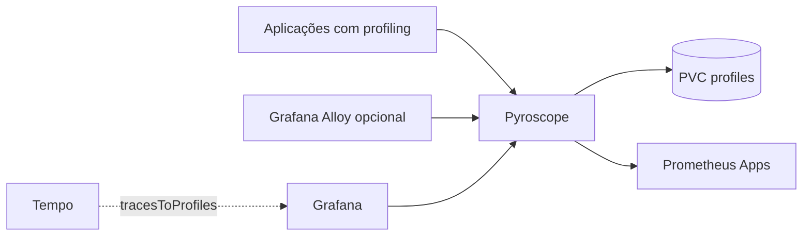

# Pyroscope GitOps

Backend GitOps do Grafana Pyroscope para OpenShift Local/CRC, integrado ao
Grafana Profiles Drilldown e preparado para coleta de continuous profiling.

Este repositório publica o Pyroscope em modo monolítico, sem Route pública e sem
versionar credenciais.

## Arquitetura



O perfil CRC usa `-target=all`, conforme o modo monolítico documentado pelo
Grafana Pyroscope. O metastore Raft é inicializado com um único peer estático
baseado no próprio pod (`$(POD_NAME).pyroscope-headless...`) e
`bootstrap-expect-peers=1`. O `server-id` fica sem porta, enquanto o
`advertise-address` e o `bootstrap-peers` usam `:9099`; isso evita falhas no CRC
quando a resolução DNS SRV do Service headless retorna o mesmo pod duplicado, ou
quando o bootstrap e o nó local derivam IDs diferentes para o mesmo endereço.

Esse modo é simples e adequado para laboratório; para HA ou retenção formal,
use o Helm chart oficial em modo microservices/object storage.

## Deploy

```bash
oc apply -k overlays/desenvolvimento
oc -n pyroscope get statefulset,pods,svc,pvc,servicemonitor
```

Validação declarativa:

```bash
oc kustomize overlays/desenvolvimento >/tmp/pyroscope-dev.yaml
oc apply --dry-run=server -k overlays/desenvolvimento
```

## Integração com Grafana

O `grafana-gitops` provisiona:

- datasource `pyroscope` com URL `http://pyroscope.pyroscope.svc:4040`;
- `tracesToProfiles` no datasource Tempo;
- pasta `Profiles` para dashboards futuros.

Sem aplicações instrumentadas, o datasource fica saudável, mas Profiles
Drilldown não mostrará flamegraphs. Para correlação trace → profile, as spans
precisam carregar labels compatíveis e, idealmente, `pyroscope.profile.id`.

Manual geral de instrumentação: [docs/COMO-INSTRUMENTAR.md](docs/COMO-INSTRUMENTAR.md).

## Troubleshooting

Se o pod ficar em `CrashLoopBackOff`, confira primeiro o bootstrap Raft:

```bash
oc -n pyroscope logs pyroscope-0 --tail=120
```

O erro abaixo indica que o Service headless/SRV DNS retornou peers duplicados:

```text
expected number of bootstrap peers not reached: got 2, expected 1
```

Neste repositório o bootstrap usa peer estático para o modo monolítico CRC. Se
o erro voltar após alterações, valide se o argumento abaixo continua renderizado
no StatefulSet:

```bash
oc -n pyroscope get pod pyroscope-0 -o \
  jsonpath='{.spec.containers[?(@.name=="pyroscope")].args}'
```

## Segurança

- Sem Route pública.
- NetworkPolicy libera somente Grafana, Prometheus Apps, Zabbix, namespace
  `observability`, namespaces rotulados com `observability=enabled` e tráfego
  interno do próprio Pyroscope. Use essa label nos namespaces de aplicações que
  enviarão profiles para o Pyroscope, evitando regras presas a nomes de
  ambientes como `dev`, `aceite` ou `producao`.
- ServiceAccount com Role local apenas para descoberta de endpoints/pods usada
  pelo backend.
- Sem Secrets obrigatórios neste perfil.

## Ambientes

Veja [docs/AMBIENTES.md](docs/AMBIENTES.md).

## Referências

- [Grafana Pyroscope](https://grafana.com/docs/pyroscope/latest/)
- [Deploy com Helm](https://grafana.com/docs/pyroscope/latest/deploy-kubernetes/helm/)
- [Deployment modes](https://grafana.com/docs/pyroscope/latest/reference-pyroscope-architecture/deployment-modes/)
- [Grafana Pyroscope datasource](https://grafana.com/docs/grafana/latest/datasources/pyroscope/configure-pyroscope-data-source/)
